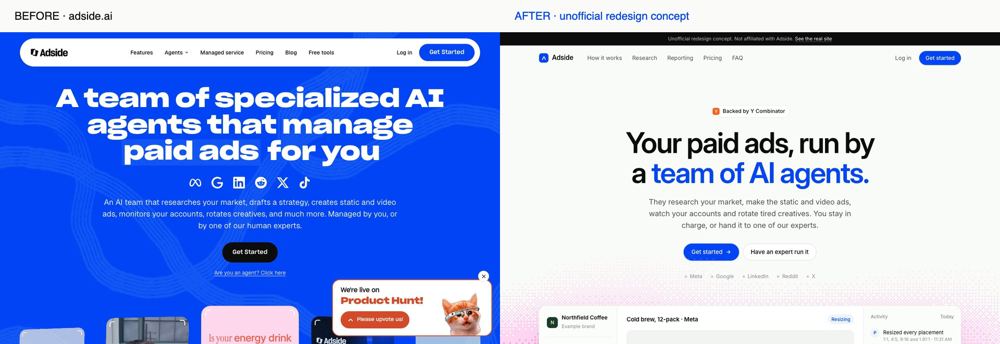
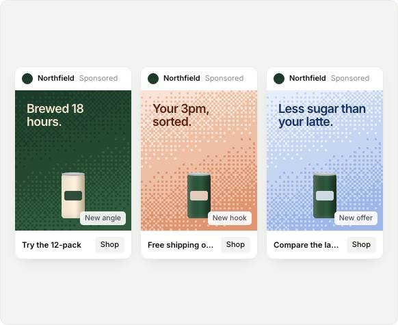
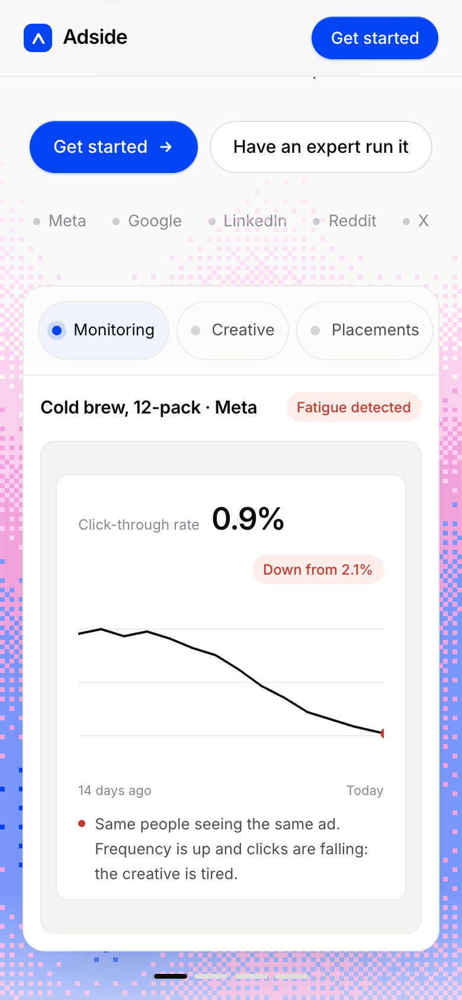

# Adside: a redesign concept

An unofficial redesign of [adside.ai](https://adside.ai/), a Y Combinator Fall 2026 company that runs paid ads with a team of AI agents.

**Live:** https://arjunkshah12345-hash.github.io/adside-redesign/



Side-by-side scroll recording: [media/before-after.mp4](media/before-after.mp4)

> Not affiliated with Adside. Their name, pricing, founders' quote and the retargeting chat come from their own site. "Northfield Coffee", its ads and every number in the console are written for this concept and labelled as examples on the page.

## The idea

The original page shouts: a saturated blue hero, a heavy display face, sticker tags, a Product Hunt popup and screenshots in tilted frames. Under it is a product worth showing calmly: agents that notice a tired ad, write new ones, resize them for every placement and wait for your approval.

So the hero is that loop, playing in a console for an example brand:

1. An ad's click-through rate drops from 2.1% to 0.9%. Fatigue detected.
2. The creative agent drafts three variations: a new angle, a new hook, a new offer.
3. Each one is resized for 1:1, 4:5, 9:16 and 1.91:1.
4. It all lands in review, launched as paused until you approve.

The rest of the page answers the next questions in order: research, chat, reporting (3.5 hours down to 2.5 minutes), the tools it replaces, pricing, the founders and FAQ.



## How it's built

- One static `index.html`: no framework, no build step, no dependencies beyond Inter from Google Fonts.
- One typeface, one accent (Adside blue `#0144f5`, with the pink from their own palette), white cards on warm off-white.
- Hand-written 8×8 Bayer dither on Canvas 2D: a pink-to-blue field behind the console that leans toward your cursor, printed-look gradients in the example ads and a dithered closing call to action. Canvases render at low resolution, cap their frame rate and pause off-screen.
- The console pauses on hover and off-screen; its step bars are clickable; `prefers-reduced-motion` shows the finished state.
- The console stacks for phones rather than shrinking.



## Run locally

```sh
python3 -m http.server 8000
# open http://localhost:8000
```

## License

MIT for the code. The Adside name belongs to its owners.
